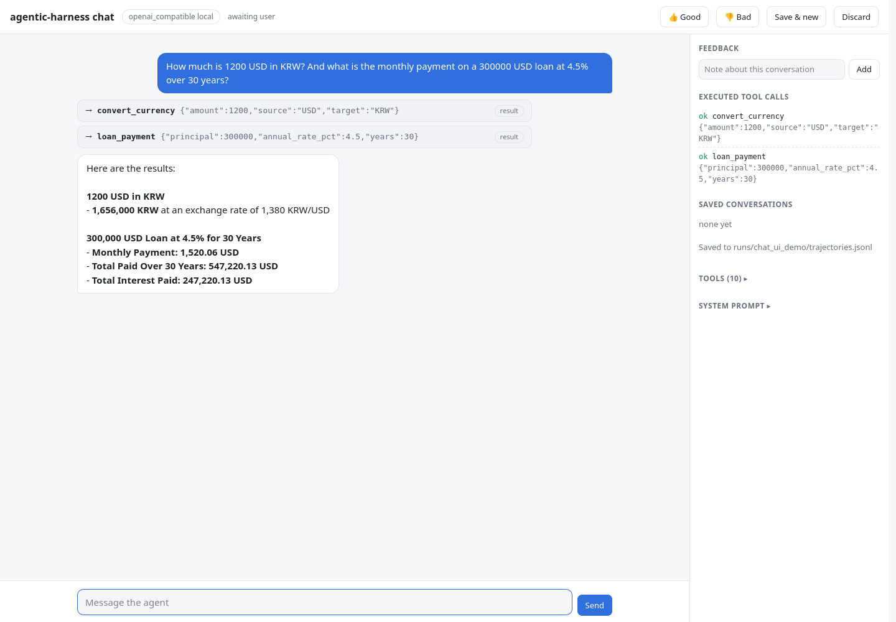

# agentic-harness (한국어)

임의의 LLM을 툴을 쓰는 에이전트로 실행하고, 그 결과를 검증하고, 모든 과정을 trajectory로 남기는 하네스입니다.

모델에 **툴**(직접 만든 Python 함수·클래스), **스킬**(`SKILL.md` 폴더), **외부 MCP 서버**를 붙이면, 모델이 여러 턴에 걸쳐
문제를 풀거나 터미널·브라우저에서 사람과 대화합니다. 에피소드 하나가 JSON 한 줄로 저장되고, 여기에는 대화 전체, 모든 툴
호출과 결과, 검증된 결과가 들어 있습니다. 이 파일로 평가 리포트를 만들거나 학습 데이터(SFT, DPO, 멀티턴 RL)를 만들 수 있습니다.

자세한 문서는 영어로 되어 있습니다([README.md](README.md), [docs/](docs/)).



## 기능

| | |
|---|---|
| **모델 지정** | OpenAI 호환 서버(OpenAI, vLLM, SGLang, Ollama, LM Studio 등), Anthropic(공식 SDK), 로컬 Hugging Face 모델, RL 데이터용 토큰 단위 vLLM, 직접 만든 Python 정책 클래스 |
| **자체 툴** | `@tool` 함수(타입 힌트와 docstring으로 스키마 자동 생성), 상태를 가진 `Toolkit` 클래스, 파일·모듈 단위로 등록 |
| **스킬** | Agent Skills 형식(`SKILL.md` + 파일). 목록만 보여 주고 필요할 때 불러오기(`load_skill`, `read_skill_file`), 프롬프트에 넣기, 끄기(비교 실험)를 지원. 스크립트가 든 스킬은 셸 툴킷(기본 꺼짐)으로 실행 |
| **외부 MCP 서버** | 흔히 쓰는 `mcpServers` JSON으로 등록, stdio·Streamable HTTP 지원, 툴 이름은 `mcp__<서버>__<툴>`, 에피소드마다 새 서버 프로세스와 작업 폴더 |
| **직접 대화** | 터미널이나 브라우저에서 에이전트와 직접 대화하고, 대화마다 👍/👎 평가와 메모가 붙은 trajectory로 저장 |
| **검증** | 최종 상태 확인(내장 환경, 툴킷, 에피소드 뒤 MCP 서버 재조회), 답 확인(문자열·숫자·정규식), 금지 행동·정보 누출, 부분 점수가 가능한 Python 검증기. 하네스 오류는 모델 실패와 분리 |
| **학습 데이터** | ms-swift SFT, OpenAI chat 형식, 단계 단위 DPO 내보내기, 평가와 같은 툴·채점기를 쓰는 ms-swift GRPO 멀티턴 플러그인 |
| **내장 벤치마크** | 결정적 환경 5종(retail, workspace, filesystem, REST 여행 API, SQL)과 스킬·MCP 문제. 영어·한국어 템플릿 80종, 검증 게이트를 거쳐 생성 |

코어는 Python 3.10 이상 표준 라이브러리만 씁니다(**필수 의존성 없음**).

## 설치

```bash
git clone <repo-url> agentic-harness && cd agentic-harness
pip install -e ".[mcp-examples]"     # 하네스 + 예시 MCP 서버에 필요한 공식 `mcp` SDK
```

선택 설치: `.[anthropic]`(Claude 백엔드), `.[hf]`(로컬 transformers 백엔드와 `serve-hf`), `.[yaml]`(YAML 설정),
`.[dev]`(pytest, ruff와 테스트에 쓰는 선택 패키지 전부).

모델 없이 설치를 확인할 수 있습니다. 예시 문제 11개의 정답 풀이를 그대로 실행해, 모든 종류의 툴이 동작하는지 봅니다.

```bash
agentic-harness run --config examples/configs/oracle_quickstart.json     # pass@1 = 1.000 (채점 10개 + 채점 없음 1개)
agentic-harness resources                                                # 스킬 목록, MCP 서버별 기동 확인과 툴 목록
```

## 사용법

### 1. 모델 연결

OpenAI 호환 `/v1/chat/completions` 엔드포인트가 있는 서버면 됩니다.

```bash
vllm serve <hf-model> --served-model-name my-model --port 8000 --enable-auto-tool-choice --tool-call-parser <parser>
# GPU 없이 작은 로컬 모델로:
agentic-harness serve-hf --model /path/to/hf_model --device cpu --port 8000
```

`--tool-call-parser`는 모델의 채팅 템플릿에 맞춰야 합니다(Qwen3.5는 `qwen3_xml`, `scripts/serve_vllm.sh` 참고).
아래 모든 명령에 같은 모델 옵션을 씁니다.

| 백엔드 | 옵션 |
|---|---|
| OpenAI 호환 서버 | `--provider openai_compatible --base-url http://127.0.0.1:8000/v1 --model my-model` |
| OpenAI | `--provider openai --model gpt-...` (`OPENAI_API_KEY`) |
| Anthropic | `--provider anthropic --model claude-opus-5-5` (`pip install -e ".[anthropic]"`, `ANTHROPIC_API_KEY`) |
| 로컬 HF 모델(서버 없이) | `--provider hf_local --model /path/to/hf_model --device cpu` |

샘플링: `--temperature`, `--top-p`, `--top-k`, `--max-new-tokens`, `--think`(하이브리드 thinking 모델).
전체 목록은 [docs/models.md](docs/models.md).

### 2. 에이전트와 대화(터미널)

```bash
agentic-harness chat --provider openai_compatible --base-url http://127.0.0.1:8000/v1 --model my-model \
    --toolkits examples/tools/finance_tools.py --use-mcp kanban
```

```
you> 'Upgrade database driver' 카드 담당자가 누구야?
  -> mcp__kanban__list_cards {}
  <- {"card_id": "CARD-101", "title": "Upgrade database driver", "column": "todo", "assignee": "david", ...}
agent> The card "Upgrade database driver" (CARD-101) is assigned to **david**.
you> /good
```

툴 호출과 결과가 실시간으로 출력됩니다. 명령어:

| 명령 | 기능 |
|---|---|
| `/good`, `/bad`, `/note 텍스트` | 대화 평가와 메모 |
| `/calls` | 실제로 실행된 툴 호출 목록. 에이전트가 "처리했다"고만 말하는지 확인할 때 사용 |
| `/tools`, `/system` | 에이전트가 받은 툴 목록과 시스템 프롬프트 |
| `/new` | 저장하고 새 대화 시작 |
| `/discard` | 저장하지 않고 버리기 |
| `/retry` | 모델 오류가 났을 때 다시 요청 |
| `/quit` | 저장하고 종료 |

### 3. 에이전트와 대화(브라우저)

같은 명령에 `--ui`를 붙이고 http://127.0.0.1:7860 을 엽니다.

```bash
agentic-harness chat --ui --provider openai_compatible --base-url http://127.0.0.1:8000/v1 --model my-model \
    --toolkits examples/tools/finance_tools.py --use-mcp kanban
```

| 위치 | 내용 |
|---|---|
| 대화 영역 | 메시지가 실시간으로 표시되고, 툴 호출은 카드로 나옵니다(`running` → `result` / `error`, 클릭하면 인자와 결과 전체) |
| 상단 바 | **👍 Good** / **👎 Bad**(한 번 더 누르면 취소), **Save & new**(저장하고 새 대화, 툴 상태도 초기화), **Discard**(저장 없이 버리기) |
| 오른쪽 패널 | 메모, 실제 실행된 툴 호출(*Executed tool calls*), 저장된 대화와 저장 파일 위치, 툴 목록, 시스템 프롬프트 |
| 입력창 | Enter 전송(한글 조합 중에는 전송 안 됨), Shift+Enter 줄바꿈, **Stop**으로 현재 답변 중단, 오류나 Stop 뒤에 빈 칸으로 Send를 누르면 다시 요청 |

추가 패키지 없이 동작합니다(표준 라이브러리 서버 + HTML 한 장). 브라우저 탭마다 대화가 따로 유지되고, 서버를 끄면 열린
대화도 저장됩니다. **인증 기능이 없으므로** 기본값 `--host 127.0.0.1`로 띄우고, 원격 서버라면 SSH나 VS Code 포트 포워딩으로
접속하세요.

에이전트는 기본으로 등록된 툴킷·스킬·MCP 서버를 모두 씁니다. `--use-toolkits`, `--use-skills`, `--use-mcp`로 고를 수 있고
(이름 없이 쓰면 없음), `--env retail --seed 3`처럼 내장 환경을 붙일 수 있습니다. 대화는 `runs/chat/`에 쌓입니다(`--out`으로 변경).

- `trajectories.jsonl`: 대화 1개 = 1줄. `human_feedback`(평가, 메모) 포함
- `tasks.jsonl`: 대화의 사용자 발화를 문제 형식으로 저장. `agentic-harness run`으로 다른 모델에 같은 요청을 재실행

자세한 내용은 [docs/chat.md](docs/chat.md).

### 4. 문제 실행(평가와 데이터 생성)

```bash
agentic-harness run --provider openai_compatible --base-url http://127.0.0.1:8000/v1 --model my-model \
    --tasks examples/tasks/quickstart.json --toolkits examples/tools/finance_tools.py \
    --toolkits examples/tools/todo_toolkit.py --toolkits examples/tools/library_toolkit.py --allow-shell \
    --n-attempts 4 --out runs/qs_mymodel
agentic-harness view runs/qs_mymodel/trajectories.jsonl --failed --limit 5      # 실패 사례를 Markdown으로 보기
```

`--out` 폴더에 `trajectories.jsonl`, `summary.json`, `report.md`(pass@1, pass@k, pass^k, 분류별 결과, 행동 진단),
`run_config.json`이 생깁니다. 모든 옵션은 JSON/YAML 설정 파일로도 쓸 수 있습니다
(`agentic-harness run --config examples/configs/openai_quickstart.json`). `agentic-harness chat --config`는 같은 파일의
모델과 리소스 설정을 그대로 씁니다.

## 직접 정의하기

**문제**: `instruction`만 있으면 되고, 검증 조건을 추가합니다([docs/tasks.md](docs/tasks.md)).

```json
{"tasks": [{
  "id": "mortgage",
  "instruction": "I'm taking a $300,000 mortgage at 4.5% for 30 years. What will my monthly payment be?",
  "toolkits": ["finance"],
  "verify": {"answers": [{"number": 1520.06, "tol": 0.5}]}
}]}
```

**툴**: `--toolkits my_tools.py`로 등록합니다([docs/tools.md](docs/tools.md)).

```python
from agentic_harness.tools import tool, Toolkit

@tool
def get_exchange_rate(base: str, quote: str) -> dict:
    """Get today's exchange rate.

    Args:
        base: ISO code of the base currency.
        quote: ISO code of the quote currency.
    """
    ...

class Todo(Toolkit):                 # 상태형: 에피소드마다 새 인스턴스
    name = "todo"

    def reset(self, world):
        self.db = {"items": []}

    @tool(mutating=True)
    def add_item(self, text: str) -> dict:
        """Add a todo item."""
        self.db["items"].append(text)
        return {"count": len(self.db["items"])}
```

**스킬**: 스킬마다 폴더 하나와 `SKILL.md`(front matter에 이름과 설명)를 두고 `--skills-dir path/to/skills`로 등록합니다
([docs/skills.md](docs/skills.md)).

**MCP 서버**: `mcpServers` JSON을 `--mcp-config my_servers.json`으로 등록합니다([docs/mcp.md](docs/mcp.md)).

`agentic-harness init my_project`를 실행하면 툴킷, 문제, 실행 설정 예시가 들어 있는 프로젝트를 만들어 줍니다.

## 포함된 예시

| | |
|---|---|
| 툴 | `finance`(함수), `todo`(상태형 클래스), `library`(자체 시스템 프롬프트와 검증) — `examples/tools/` |
| 스킬 | `fiscal-calendar`, `file-archiving`, `travel-api`, `csv-insights`(스크립트 포함) — `examples/skills/` |
| MCP 서버 | `kanban`, `wiki`, `memory`(공식 Python SDK, stdio·HTTP) — `examples/mcp_servers/`, 등록 파일 `examples/mcp/servers.json` |
| 문제 | `examples/tasks/quickstart.json`: 위 예시를 모두 쓰는 11개 문제(Python 검증기, 채점 없는 문제 포함) |
| 설정 | oracle, OpenAI 호환, Anthropic, CPU 로컬 HF, vLLM 벤치마크 — `examples/configs/` |

## 학습 데이터

```bash
agentic-harness export sft  --traj runs/x/trajectories.jsonl --out sft.jsonl --max-per-task 2   # 성공하고 형식 오류 없는 에피소드
agentic-harness export sft  --traj runs/chat/trajectories.jsonl --out chat_sft.jsonl             # 👍 평가한 대화
agentic-harness export grpo --tasks data/tasks_v0.2/dev.jsonl --out grpo.jsonl
agentic-harness export dpo  --traj runs/x/trajectories.jsonl --out dpo.jsonl                      # 실험적
```

ms-swift GRPO는 [docs/training.md](docs/training.md)를 참고하세요.

## 내장 벤치마크

`data/tasks_v0.2/`에 test(800)와 dev(320)가 들어 있습니다. `gen-tasks`는 이 둘과 train을 결정적으로 다시 만들면서 검증
게이트를 돌립니다. 정답 풀이는 모두 1점이어야 하고(MCP 문제는 실제 서버로 확인), 아무것도 안 하는 모델은 거절 문제를
빼면 모두 0점이어야 하며, 평가용 문장이 train에 섞이지 않아야 합니다. [docs/benchmark.md](docs/benchmark.md)

## 보안 주의

- 셸 툴킷(스크립트가 든 스킬에 필요)은 **기본으로 꺼져 있고**, 켜더라도 **샌드박스가 아닙니다**.
- stdio MCP 서버와 사용자 툴은 실행한 사람의 권한으로 돌아갑니다. stdio 서버는 최소한의 환경 변수만 넘겨받아 API 키가 전달되지
  않습니다(`inherit_env`로 변경 가능). 신뢰하는 코드만 등록하세요.
- 채팅 UI는 인증이 없으므로 localhost 밖으로 열지 마세요.
- 신뢰할 수 없는 모델이나 툴은 컨테이너나 VM 안에서 실행하세요.

## 개발

```bash
pip install -e ".[dev]"
pytest tests/                      # pytest 없이: python tests/run_tests.py
```

체크포인트, ms-swift, `mcp` SDK가 필요한 테스트는 해당 패키지가 없으면 자동으로 건너뜁니다.

## 라이선스

Apache License 2.0. [LICENSE](LICENSE) 참고.
