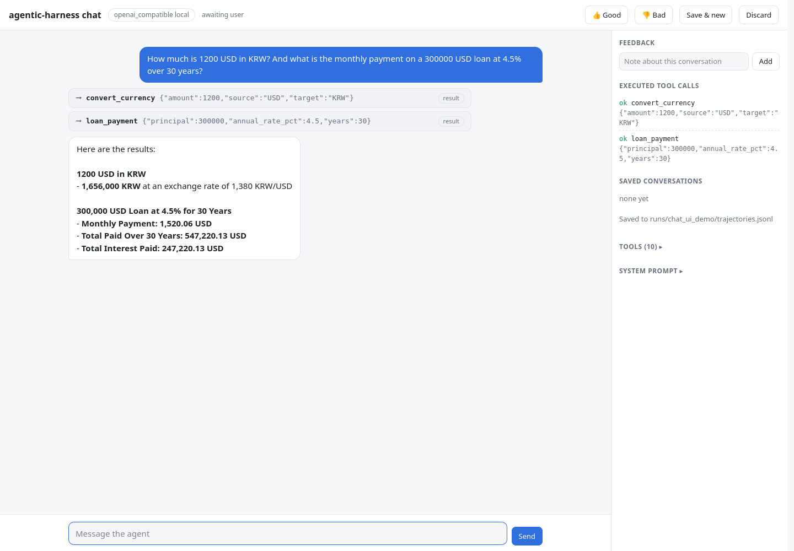

# agentic-harness

Run any LLM as a tool-using agent, verify what it did, and keep every step as a trajectory.

You give a model **tools** (your own Python functions or classes), **skills** (`SKILL.md` folders) and **external MCP
servers**; it solves tasks over several turns, or chats with you in the terminal or the browser. Each episode is saved
as one JSON line with the full conversation, every tool call and its result, and a verified outcome, ready for
evaluation reports or for training data (SFT, DPO, multi-turn RL).

```
task or your message ─► model ⇄ tools (Python toolkits · skills · MCP servers · built-in envs) ─► verify ─► trajectories.jsonl
                                                                                                      ├─► report (pass@k, pass^k)
                                                                                                      └─► SFT / DPO / GRPO data
```



## Features

| | |
|---|---|
| **Any model** | OpenAI-compatible servers (OpenAI, vLLM, SGLang, Ollama, LM Studio, ...), Anthropic (official SDK), local Hugging Face models, token-level vLLM for RL data, or your own Python policy class |
| **Your tools** | `@tool` functions with schemas inferred from type hints and docstrings, stateful `Toolkit` classes, loaded from a file or module |
| **Skills** | Agent Skills layout (`SKILL.md` + files), offered by progressive disclosure (`load_skill`, `read_skill_file`), inline, or not at all for ablations; skills that ship scripts run with the opt-in shell toolkit |
| **External MCP servers** | the usual `mcpServers` JSON; stdio and Streamable HTTP; tools appear as `mcp__<server>__<tool>`; a fresh server process and sandbox directory per episode |
| **Chat** | talk to the agent yourself in the terminal or the browser; conversations are saved as trajectories with your 👍/👎 rating and notes |
| **Verification** | final-state checks (built-in envs, toolkits, MCP servers queried after the episode), answer checks (text / number / regex), forbidden actions and leaks, Python verifiers with partial credit; infrastructure failures are kept apart from model failures |
| **Training data** | exporters to ms-swift SFT, OpenAI chat format and step-level DPO pairs, plus an ms-swift GRPO multi-turn plugin that uses the same tools and scorer as evaluation |
| **Built-in benchmark** | 5 deterministic environments (retail, workspace, filesystem, REST travel API, SQL) plus skill and MCP tasks: 80 templates in English and Korean, generated with validation gates |

The core is pure Python 3.10+ with **no required dependencies**.

## Install

```bash
git clone <repo-url> agentic-harness && cd agentic-harness
pip install -e ".[mcp-examples]"     # the harness + what the bundled example MCP servers need (official `mcp` SDK)
```

Optional extras: `.[anthropic]` (Claude backend), `.[hf]` (local transformers backend and `serve-hf`), `.[yaml]`
(YAML configs), `.[dev]` (pytest, ruff and every optional package used by the tests).

Check the setup without a model. This replays the reference solutions of the 11 example tasks, which use every kind
of tool:

```bash
agentic-harness run --config examples/configs/oracle_quickstart.json     # expect pass@1 = 1.000 (10 scored + 1 unscored)
agentic-harness resources                                                # lists the skills, starts each MCP server, lists its tools
```

## Usage

### 1. Connect a model

Any server with an OpenAI-compatible `/v1/chat/completions` endpoint works, for example:

```bash
vllm serve <hf-model> --served-model-name my-model --port 8000 --enable-auto-tool-choice --tool-call-parser <parser>
# or, without a GPU, a small local model:
agentic-harness serve-hf --model /path/to/hf_model --device cpu --port 8000
```

(`--tool-call-parser` must match the model's chat template, e.g. `qwen3_xml` for Qwen3.5; `scripts/serve_vllm.sh` wraps
this.) The same model flags are used by every command below:

| provider | flags |
|---|---|
| OpenAI-compatible server | `--provider openai_compatible --base-url http://127.0.0.1:8000/v1 --model my-model` |
| OpenAI | `--provider openai --model gpt-...` (`OPENAI_API_KEY`) |
| Anthropic | `--provider anthropic --model claude-opus-5-5` (`pip install -e ".[anthropic]"`, `ANTHROPIC_API_KEY`) |
| local HF model, no server | `--provider hf_local --model /path/to/hf_model --device cpu` |

Sampling: `--temperature`, `--top-p`, `--top-k`, `--max-new-tokens`, `--think` (hybrid-thinking models). All
providers: [docs/models.md](docs/models.md).

### 2. Chat with the agent (terminal)

```bash
agentic-harness chat --provider openai_compatible --base-url http://127.0.0.1:8000/v1 --model my-model \
    --toolkits examples/tools/finance_tools.py --use-mcp kanban
```

```
you> 'Upgrade database driver' 카드 담당자가 누구야?
  -> mcp__kanban__list_cards {}
  <- {"card_id": "CARD-101", "title": "Upgrade database driver", "column": "todo", "assignee": "david", ...}
agent> The card "Upgrade database driver" (CARD-101) is assigned to **david**.
you> /good
```

Tool calls and results are printed as they happen. Commands: `/good`, `/bad` and `/note` (feedback), `/calls` (tool
calls that really ran, useful when the agent claims it did something), `/tools`, `/system`, `/new` (save and start
over), `/discard`, `/retry`, `/quit`.

### 3. Chat with the agent (browser)

Add `--ui` to the same command and open http://127.0.0.1:7860:

```bash
agentic-harness chat --ui --provider openai_compatible --base-url http://127.0.0.1:8000/v1 --model my-model \
    --toolkits examples/tools/finance_tools.py --use-mcp kanban
```

| where | what |
|---|---|
| conversation | messages stream in; each tool call is a card (`running` → `result` / `error`; click for arguments and the full result) |
| top bar | **👍 Good** / **👎 Bad** (click again to clear), **Save & new** (save and start a fresh conversation with fresh tool state), **Discard** |
| side panel | notes, *Executed tool calls*, saved conversations and the output file, the tool list and the system prompt |
| input | Enter sends (not while an IME is composing), Shift+Enter adds a line; **Stop** ends the current answer; an empty Send after an error or Stop asks again |

The UI needs no extra packages (a stdlib server and one HTML page). Each browser tab keeps its own conversation, and
stopping the server saves the open ones. It has **no authentication**: keep the default `--host 127.0.0.1` and, on a
remote machine, use SSH or VS Code port forwarding.

By default the agent gets every registered toolkit, skill and MCP server; narrow it with `--use-toolkits`,
`--use-skills`, `--use-mcp` (a flag with no names offers none), or attach a built-in environment with
`--env retail --seed 3`. Conversations go to `runs/chat/` (`--out` to change):

- `trajectories.jsonl`: one line per conversation, with `human_feedback` (rating, notes);
- `tasks.jsonl`: the conversation's user turns as a task, to replay with other models via `agentic-harness run`.

More in [docs/chat.md](docs/chat.md).

### 4. Run tasks (evaluation and data generation)

```bash
agentic-harness run --provider openai_compatible --base-url http://127.0.0.1:8000/v1 --model my-model \
    --tasks examples/tasks/quickstart.json --toolkits examples/tools/finance_tools.py \
    --toolkits examples/tools/todo_toolkit.py --toolkits examples/tools/library_toolkit.py --allow-shell \
    --n-attempts 4 --out runs/qs_mymodel
agentic-harness view runs/qs_mymodel/trajectories.jsonl --failed --limit 5      # read failures as Markdown
```

A run writes `trajectories.jsonl`, `summary.json`, `report.md` (pass@1, unbiased pass@k, pass^k, breakdowns, behaviour
diagnostics) and `run_config.json` to `--out`. Every option can also live in a JSON/YAML config:
`agentic-harness run --config examples/configs/openai_quickstart.json`. `agentic-harness chat --config` reuses the
model and resources of the same file.

## Bring your own

**Tasks**: only `instruction` is required; add what to verify ([docs/tasks.md](docs/tasks.md)).

```json
{"tasks": [{
  "id": "mortgage",
  "instruction": "I'm taking a $300,000 mortgage at 4.5% for 30 years. What will my monthly payment be?",
  "toolkits": ["finance"],
  "verify": {"answers": [{"number": 1520.06, "tol": 0.5}]}
}]}
```

**Tools**: register with `--toolkits my_tools.py` ([docs/tools.md](docs/tools.md)).

```python
from agentic_harness.tools import tool, Toolkit, ToolError

@tool
def get_exchange_rate(base: str, quote: str) -> dict:
    """Get today's exchange rate.

    Args:
        base: ISO code of the base currency.
        quote: ISO code of the quote currency.
    """
    ...

class Todo(Toolkit):                 # stateful: a fresh instance per episode
    name = "todo"

    def reset(self, world):
        self.db = {"items": []}

    @tool(mutating=True)
    def add_item(self, text: str) -> dict:
        """Add a todo item."""
        self.db["items"].append(text)
        return {"count": len(self.db["items"])}
```

**Skills**: a folder per skill with a `SKILL.md` (name and description in the front matter), registered with
`--skills-dir path/to/skills` ([docs/skills.md](docs/skills.md)).

**MCP servers**: an `mcpServers` JSON registered with `--mcp-config my_servers.json` ([docs/mcp.md](docs/mcp.md)).

```json
{"mcpServers": {
  "kanban": {"command": "${PYTHON}", "args": ["${CONFIG_DIR}/../mcp_servers/kanban_server.py", "--state", "${EPISODE_DIR}/k.json"],
             "scope": "episode"},
  "remote": {"type": "http", "url": "https://example.com/mcp", "headers": {"Authorization": "Bearer ${env:TOKEN}"},
             "scope": "run"}
}}
```

`agentic-harness init my_project` scaffolds a toolkit, tasks and run configs to start from.

## Bundled examples

| | |
|---|---|
| tools | `finance` (functions), `todo` (stateful class), `library` (own system prompt and custom checks) in `examples/tools/` |
| skills | `fiscal-calendar`, `file-archiving`, `travel-api`, `csv-insights` (with a script) in `examples/skills/` |
| MCP servers | `kanban`, `wiki`, `memory` (official Python SDK, stdio or HTTP) in `examples/mcp_servers/`, registered in `examples/mcp/servers.json` |
| tasks | `examples/tasks/quickstart.json`: 11 tasks covering all of the above, incl. Python verifiers and an unscored task |
| configs | oracle, OpenAI-compatible, Anthropic, local HF on CPU, vLLM benchmark in `examples/configs/` |

See [examples/README.md](examples/README.md).

## Training data

```bash
agentic-harness export sft  --traj runs/x/trajectories.jsonl --out sft.jsonl --max-per-task 2   # successful, clean episodes
agentic-harness export sft  --traj runs/chat/trajectories.jsonl --out chat_sft.jsonl             # chats rated 👍
agentic-harness export grpo --tasks data/tasks_v0.2/dev.jsonl --out grpo.jsonl
agentic-harness export dpo  --traj runs/x/trajectories.jsonl --out dpo.jsonl                      # experimental
```

GRPO with ms-swift: `--external_plugins agentic_harness/integrations/swift_plugin.py --multi_turn_scheduler agent_harness
--reward_funcs harness_reward`. See [docs/training.md](docs/training.md).

## Built-in benchmark

`data/tasks_v0.2/` has the test (800) and dev (320) splits; `gen-tasks` regenerates them and the train split
deterministically, running gates on the way: every reference solution must score 1.0 (against live MCP servers too),
a do-nothing policy must fail everything except refusal tasks, and evaluation prompts never appear in train.

```bash
agentic-harness run --config examples/configs/vllm_benchmark.json
agentic-harness gen-tasks --out data/tasks_v0.2 --train 150 --dev 4 --test 10
```

See [docs/benchmark.md](docs/benchmark.md).

## Python API

```python
import agentic_harness as ah

model = {"provider": "openai_compatible", "base_url": "http://127.0.0.1:8000/v1", "model": "my-model"}
trajs = ah.run_tasks("examples/tasks/quickstart.json", model=model,
                     toolkits=["examples/tools/finance_tools.py", "examples/tools/todo_toolkit.py",
                               "examples/tools/library_toolkit.py"],
                     skills_dirs=["examples/skills"], mcp_configs=["examples/mcp/servers.json"], allow_shell=True)
print(ah.summarize(trajs)["overall"])

chat = ah.ChatSession(model, toolkit_files=["examples/tools/finance_tools.py"], out_dir="runs/chat")
for message in chat.send("How much is 250 EUR in KRW?"):
    print(message["role"], message.get("content") or message.get("tool_calls"))
chat.rate("good")
chat.save()
chat.close()
```

## Documentation

[tasks](docs/tasks.md) · [tools](docs/tools.md) · [skills](docs/skills.md) · [MCP](docs/mcp.md) ·
[models](docs/models.md) · [chat](docs/chat.md) · [trajectories](docs/trajectories.md) ·
[training](docs/training.md) · [benchmark](docs/benchmark.md) · [architecture](docs/architecture.md)

## Safety

- The `shell` toolkit (needed for skills that ship scripts) is **off by default** and is **not a sandbox**.
- stdio MCP servers and user toolkits run with your permissions; stdio servers only inherit a minimal environment
  (no API keys) unless a server sets `inherit_env`. Register only code you trust.
- The chat UI has no authentication; do not expose it beyond localhost.
- Run untrusted models or tools inside a container or VM.

## Repository layout

```
agentic_harness/   core (episode loop, tool session, parser), chat.py + web/ (chat UI), envs/, tasks/ (generators),
                   policies/ (model backends), scoring/, export/, skills/, mcp/, tools.py, integrations/, commands/ (CLI)
examples/          tasks, tools, skills, MCP servers and configs
data/tasks_v0.2/   built-in benchmark (test, dev)
docs/              user documentation
scripts/           serve_vllm.sh
tests/             pytest or `python tests/run_tests.py`
```

## Development

```bash
pip install -e ".[dev]"
pytest tests/                      # or, without pytest: python tests/run_tests.py
HARNESS_TEST_CKPT=/path/to/qwen3.5-format-model pytest tests/   # also runs tokenizer / ms-swift consistency tests
```

Tests that need a checkpoint, ms-swift or the `mcp` SDK skip themselves when those are missing. See
[CONTRIBUTING.md](CONTRIBUTING.md) and [CHANGELOG.md](CHANGELOG.md).

## License

Apache License 2.0. See [LICENSE](LICENSE).
